# Bien démarrer avec Meloo · BÊTA

**[Télécharger l’installateur Windows .EXE](https://github.com/bhuit/Meloo/releases/download/v0.4.2/Meloo-0.4.2-Setup-x64.exe)** · [Retour à la présentation](README.md)

> **Meloo 0.4.2 est une version bêta. Elle peut contenir des erreurs.**
> Certaines conversions peuvent échouer ou modifier la mise en page. Conservez vos originaux et contrôlez les résultats.

## 1. Installer et démarrer

Téléchargez **Meloo-0.4.2-Setup-x64.exe** depuis les versions GitHub, puis ouvrez-le.
Choisissez le dossier et les raccourcis dans l’assistant. Windows 10/11 x64 et environ 2,5 Go sont nécessaires.
Python, LibreOffice et FFmpeg ne sont pas à installer séparément pour cette distribution complète.

L’application démarre près de l’horloge. Si l’icône est cachée, ouvrez le menu des icônes masquées.
Un clic droit sur l’icône donne accès à la roue, l’atelier, aux réglages, aux fonctionnalités et à Quitter.
L’absence de grande fenêtre au démarrage est le fonctionnement normal.

### Retrouver les réglages par un clic droit

Cliquez avec le **bouton droit de la souris sur l’icône Meloo**, en bas à droite de Windows.
Ouvrez la petite flèche des icônes masquées si nécessaire, puis choisissez **Réglages**.

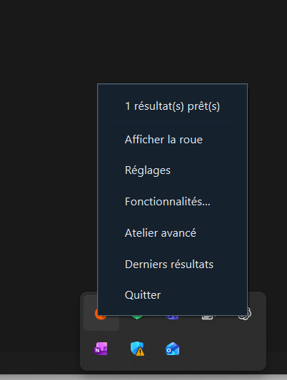

| Entrée du menu | À quoi elle sert |
| --- | --- |
| Afficher la roue | Ouvrir la roue flottante. |
| Réglages | Choisir le thème, l’opacité, le geste Ctrl et le dossier de sortie. |
| Fonctionnalités… | Activer ou désactiver les outils et les formats de destination. |
| Atelier avancé | Accéder aux fichiers, à la roue intégrée et à la galerie des résultats. |
| Derniers résultats | Retrouver les derniers fichiers produits. |
| Quitter | Fermer Meloo et retirer son icône jusqu’au prochain lancement. |

La première ligne indique l’état du dernier traitement, par exemple « 1 résultat(s) prêt(s) ».

Le programme n’est pas signé avec un certificat éditeur. Le fichier `SHA256SUMS.txt` permet de vérifier l’intégrité du téléchargement.

## 2. Convertir sans ouvrir l’atelier

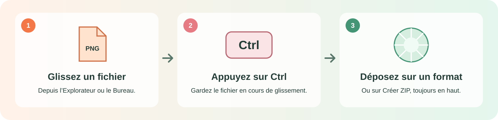

1. Dans l’Explorateur ou sur le Bureau, commencez à **glisser un fichier**.
2. Pendant le glissement, appuyez sur **Ctrl**. La roue apparaît près du pointeur.
3. Vous pouvez relâcher Ctrl en gardant le bouton de souris enfoncé.
4. Visez **le format souhaité**, puis relâchez le fichier sur le secteur.
5. La roue se ferme et Meloo traite le fichier. Le résultat est créé à côté de l’original, sauf réglage différent.

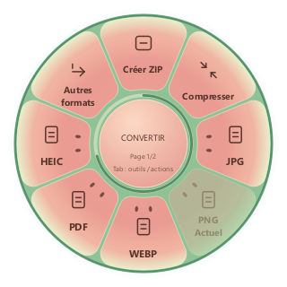

**Exemple :** glissez une image PNG, appuyez sur Ctrl et déposez-la sur **WEBP**.
Le secteur **PNG — Actuel** reste grisé, car il représente le format d’entrée.
Pour une autre destination, maintenez brièvement le pointeur sur **Autres formats**.

### Exemple : un PDF vers Word ou PowerPoint

Le secteur sous le pointeur s’éclaire et le centre indique la destination. Déposez sur **Word DOCX**
pour obtenir un document Word, ou sur **PowerPoint PPTX** pour placer les pages dans une présentation.

| Déposer sur Word | Déposer sur PowerPoint |
| --- | --- |
| 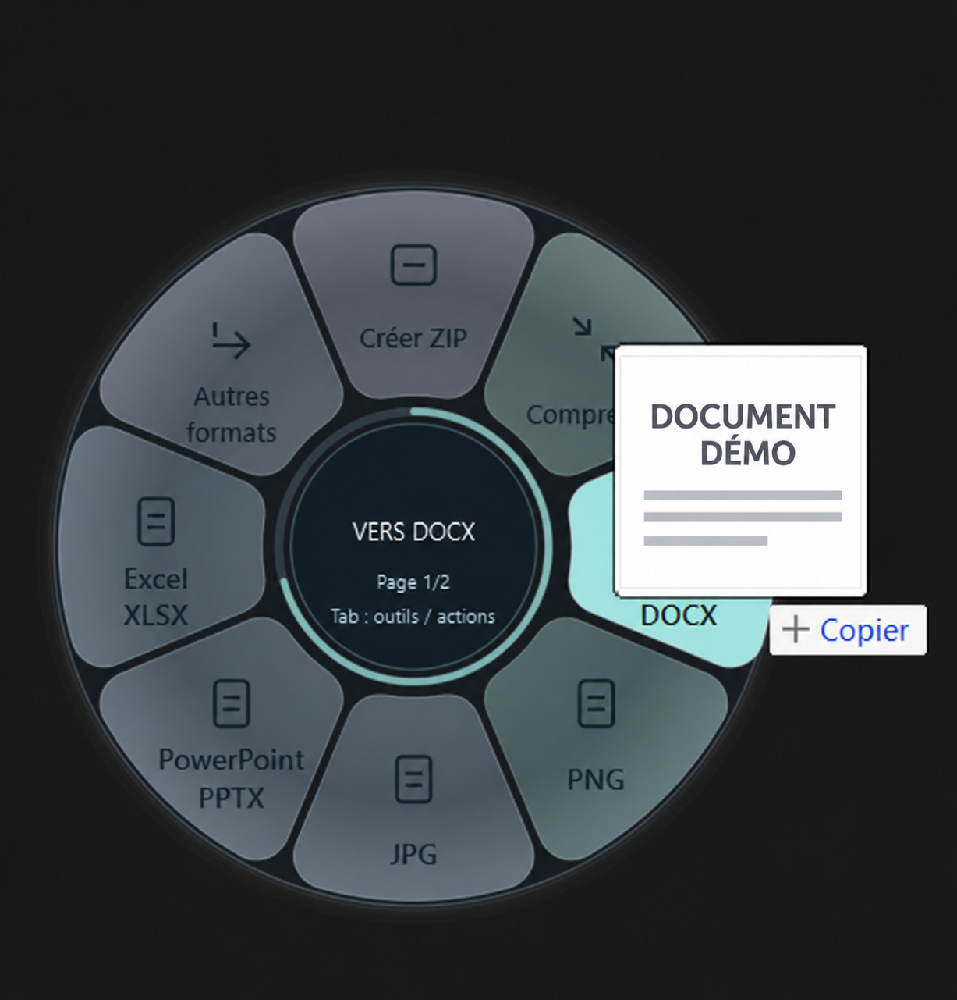 | 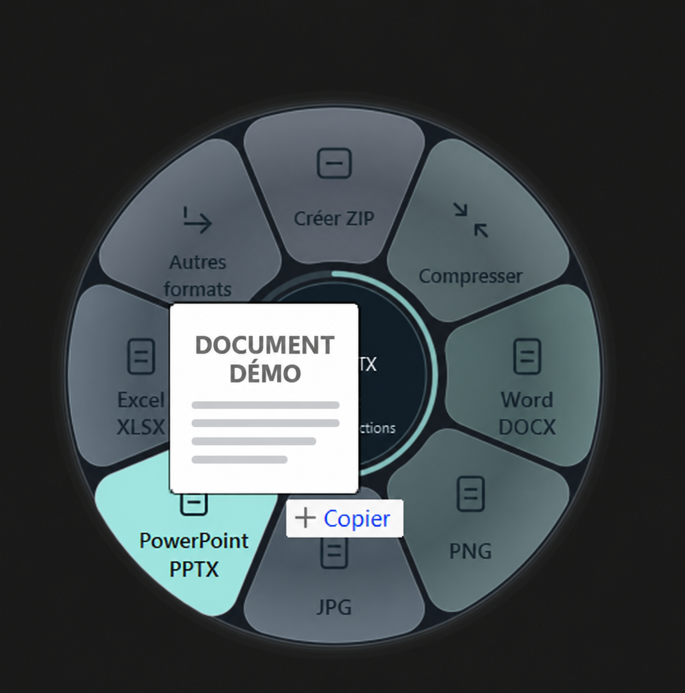 |

Le badge Windows « + Copier » accompagne le glissement ; le secteur de Meloo choisit la transformation.
**PDF → PPTX produit des images de pages, pas des zones de texte éditables.** La mise en page de PDF → DOCX peut varier.
Les aperçus des documents de ces captures ont été remplacés par une démo pour leur publication.

## 3. Compresser ou créer une archive

- **Compresser** lance le traitement automatique adapté au fichier.
- **Créer ZIP**, en haut de la roue, rassemble les fichiers sans convertir leur contenu.
- Pour les outils avancés, appuyez sur **Tab** pendant que la roue est ouverte.
- Un PDF déjà optimisé peut ne pas produire de nouvelle copie ; l’original est conservé.

## 4. Utiliser l’atelier

Ouvrez **Atelier** depuis le menu de l’icône. Ajoutez les fichiers à gauche, choisissez la destination au centre,
puis utilisez **Lancer la transformation**. La galerie présente les sorties.

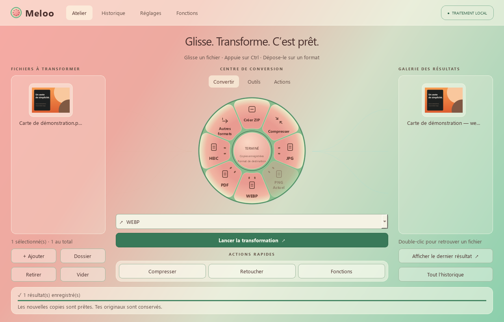

Double-cliquez sur un résultat pour le retrouver dans l’Explorateur. L’historique conserve les résultats récents et les diagnostics.

## 5. Choisir Orange ou Melina

Dans **Réglages**, le switch **Orange / Melina · Pastèque** change la palette de toute l’application.
Vous pouvez aussi régler l’opacité, réduire les animations et choisir le dossier de sortie.

1. Faites un **clic droit sur l’icône Meloo → Réglages**.
2. Basculez le switch vers **Melina · Pastèque** : la roue, l’atelier et les fenêtres adoptent les tons rose et vert.
3. Revenez sur **Orange** pour retrouver la palette d’origine.

Le changement est immédiat et le choix est conservé au prochain lancement. Les fonctionnalités restent les mêmes dans les deux styles.

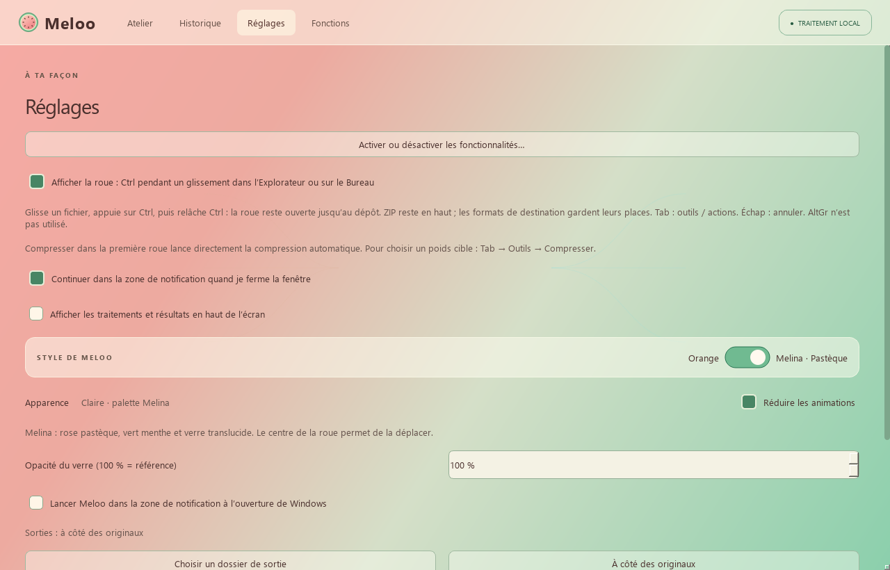

| Orange | Melina |
| --- | --- |
| 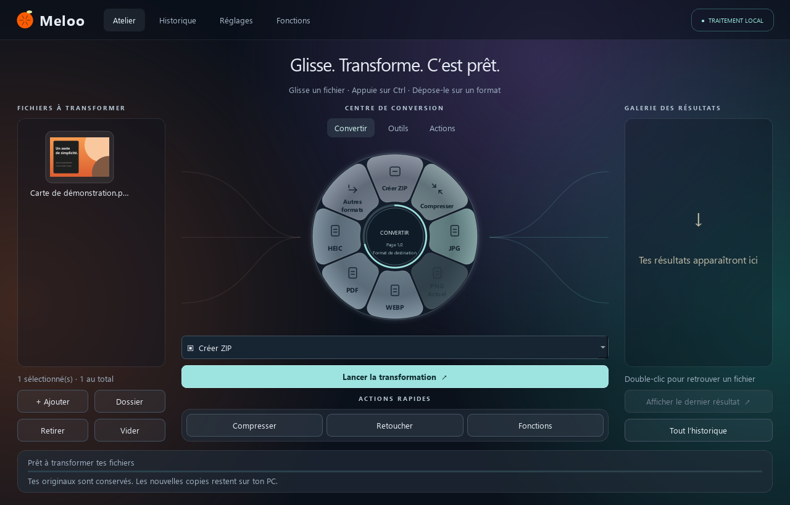 | 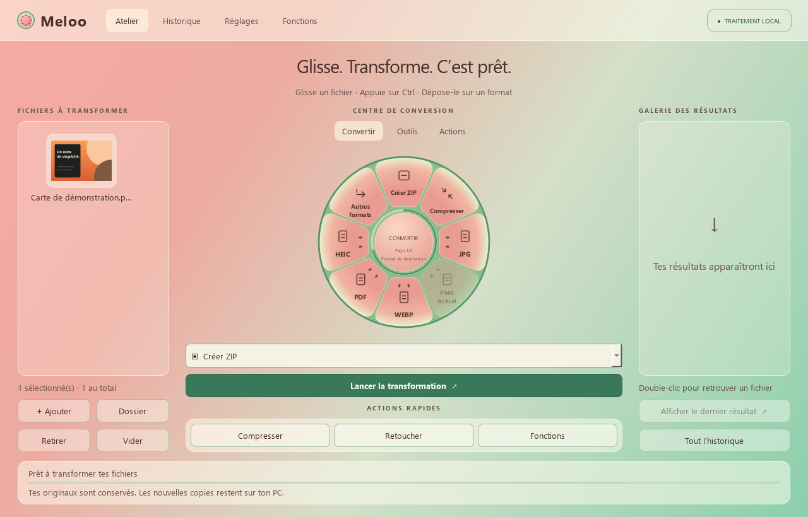 |

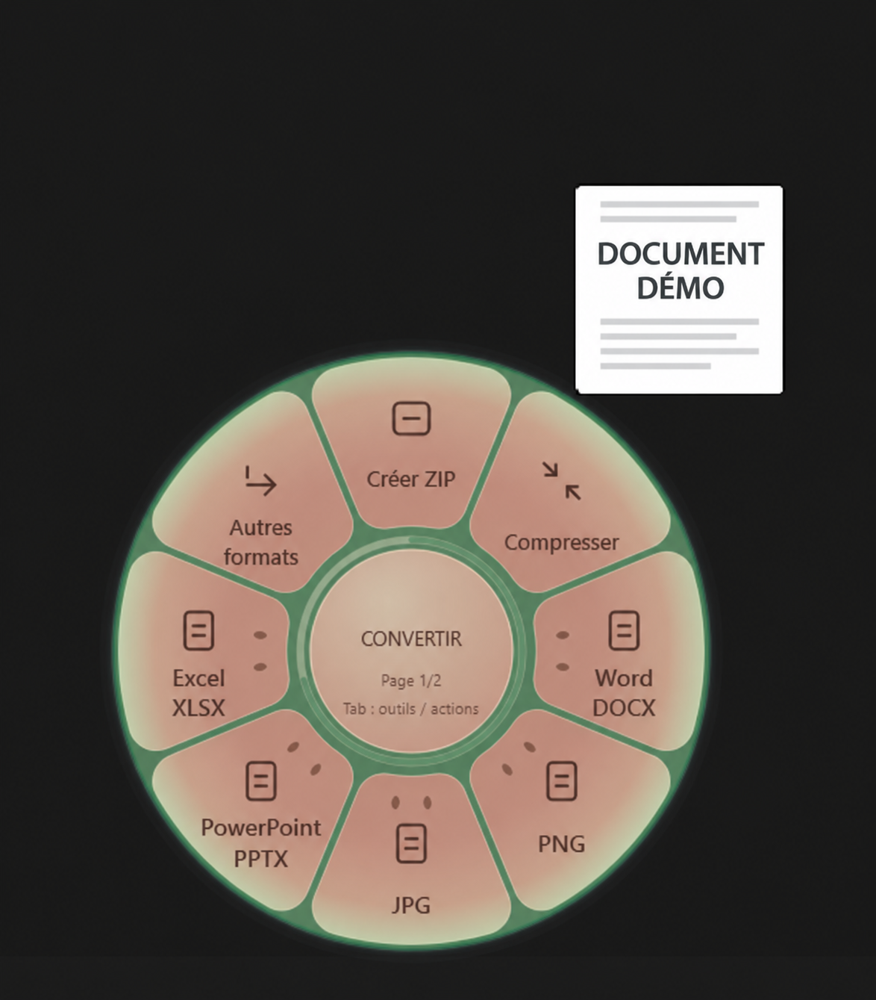

La même roue de conversion de documents, dans le style Melina. L’aperçu du document a été remplacé par une démo.

## 6. Choisir les fonctionnalités visibles

Ouvrez **Fonctions** ou **Activer ou désactiver les fonctionnalités…** dans les réglages.
Recherchez un outil et cochez les options utiles. Le type du fichier et la sélection déterminent aussi les outils proposés.

Vous pouvez aussi y accéder directement par **clic droit sur l’icône → Fonctionnalités…**.
Utilisez le champ de recherche pour trouver un outil ou un format, puis cochez pour l’afficher ou décochez pour le masquer.
**Tout activer** et **Tout désactiver** agissent sur l’ensemble des fonctionnalités. Les changements sont enregistrés immédiatement.

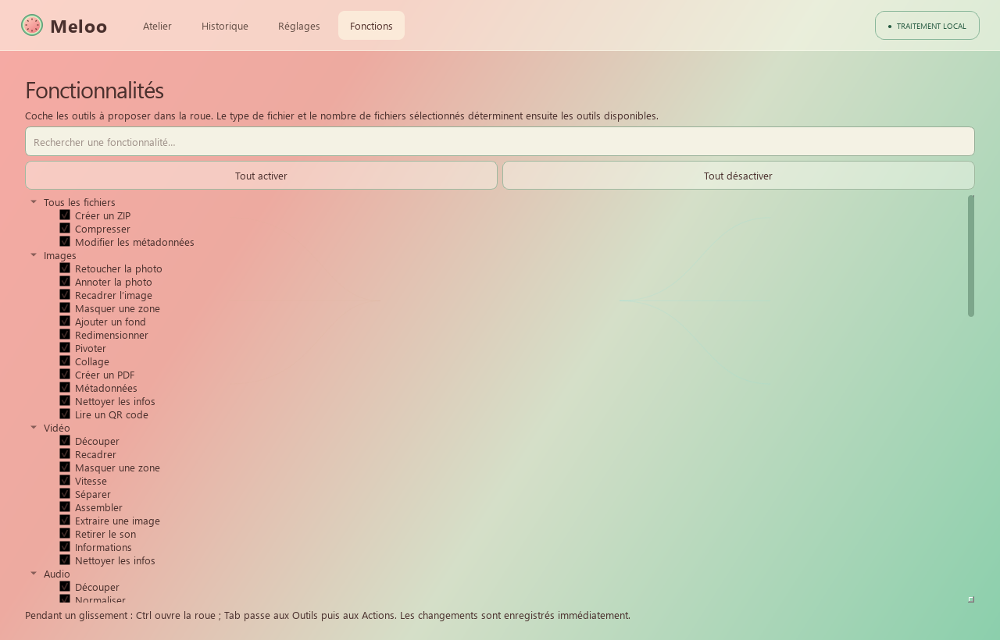

La rubrique **Conversions** contrôle les formats de destination proposés. Cocher un format ne le rend pas compatible
avec tous les fichiers : les destinations dépendent toujours du fichier d’entrée.

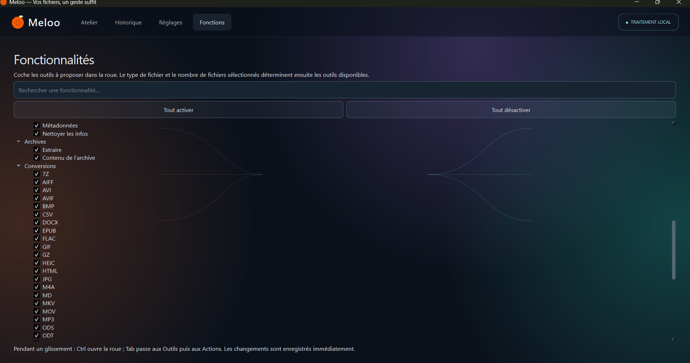

## 7. Les fonctionnalités en détail

### Convertir, utiliser un outil ou agir sur un fichier

- **Convertir** : changer le format, par exemple PNG → WebP ou DOCX → PDF.
- **Outils** : modifier le contenu, par exemple recadrer une image ou organiser les pages d’un PDF.
- **Actions** : copier, déplacer, retrouver ou partager le fichier.

Appuyez sur **Tab** lorsque la roue est ouverte pour passer d’une rubrique à l’autre.
Les opérations qui nécessitent des réglages ouvrent une fenêtre adaptée. Sélectionnez plusieurs fichiers
pour les opérations de groupe, comme le collage, la fusion PDF ou l’assemblage audio/vidéo.

### Images

| Outil | Utilisation |
| --- | --- |
| Retoucher la photo | Ajuster la lumière, les couleurs et le détail avec un aperçu. |
| Annoter | Ajouter du texte, des flèches, des formes ou du dessin. |
| Recadrer, redimensionner, pivoter | Changer le cadrage, les dimensions ou l’orientation. |
| Masquer une zone | Appliquer un aplat ou un flou dans une nouvelle copie. |
| Ajouter un fond | Créer une marge, des coins arrondis et une ombre autour de l’image. |
| Collage / Créer un PDF | Réunir plusieurs images dans une composition ou un document. |
| Métadonnées / Lire un QR code | Consulter les informations disponibles ou décoder un QR code. |

Destinations courantes : **JPG, PNG, WebP, PDF, HEIC, AVIF, TIFF, BMP, GIF**.
Les outils photo traitent un GIF comme une image fixe ; SVG est un format d’entrée, pas une destination.

### Vidéo

**Compresser**, couper un extrait, recadrer, masquer une zone par un rectangle noir, modifier la vitesse,
séparer ou assembler des séquences, extraire une image et retirer le son.
Conversions vers **MP4, MOV, MKV, WebM, GIF, AVI, WMV**, ou extraction audio vers **MP3/WAV**, selon l’entrée et les codecs disponibles.

### Audio

**Compresser**, couper un extrait, normaliser le volume, remplacer un passage par un bip,
choisir mono/stéréo, modifier la vitesse, séparer ou assembler des pistes.
**Onde en vidéo** crée une vidéo MP4 représentant le son.
Destinations : **MP3, WAV, M4A, FLAC, OGG, Opus, AIFF, WMA**.

### PDF

**Compresser**, fusionner plusieurs PDF, séparer, extraire, réordonner ou pivoter les pages.
**Masquer du texte** supprime le texte sélectionné dans une copie.
Conversions proposées : **DOCX, PNG, JPG, PPTX, XLSX, TXT, Markdown, HTML, EPUB**.
La qualité dépend du contenu : un scan sans texte n’est pas reconnu par OCR, une présentation est créée en images de pages,
et Excel nécessite des tableaux détectables.

### Documents, tableaux et présentations

| Famille | Exemples de destinations |
| --- | --- |
| Documents texte | PDF, DOCX, TXT, EPUB, Markdown, HTML, ODT, RTF |
| Tableurs | XLSX, PDF, CSV, ODS, TSV |
| Présentations | PDF, PPTX, PNG, JPG |
| Sous-titres | SRT, VTT, TXT |

Les moteurs inclus effectuent ces traitements localement. Les mises en page, polices, formules ou éléments complexes
peuvent changer lors d’une conversion : contrôlez le fichier obtenu.

### Archives et actions sur tous les fichiers

**Créer ZIP** reste en haut de la roue pour les fichiers et dossiers, y compris une sélection de types différents,
tant que la fonctionnalité est activée. L’archive rassemble les fichiers sans changer leur format.
Les outils d’archives permettent de consulter leur contenu et de les extraire ; RAR requiert un extracteur externe.

Les actions permettent d’afficher le fichier dans l’Explorateur, copier les fichiers ou leur chemin,
dupliquer, copier ou déplacer vers un dossier, garder les fichiers à portée, ouvrir un terminal et partager via Windows.
**Empreinte SHA-256** calcule une signature permettant de comparer l’intégrité de deux copies d’un fichier.

**Modifier les métadonnées** agit sur les champs intégrés lorsque le format le permet ; sinon, une fiche JSON séparée est créée.
Nettoyer les métadonnées ne retire pas les informations écrites dans les pages, les images ou le son.
Pour les PDF, les mentions de logiciel et de droits sont conservées.

## Raccourcis utiles

| Geste | Effet |
| --- | --- |
| Ctrl pendant un glissement | Afficher la roue |
| Tab | Passer entre Convertir, Outils et Actions |
| Échap | Fermer ou annuler le choix |
| Glisser le centre de la roue, hors dépôt de fichier | Déplacer la roue |
| Clic sur le centre, hors glissement | Changer de rubrique |

## Si quelque chose ne fonctionne pas

Vérifiez que Meloo apparaît près de l’horloge et que le geste Ctrl est activé dans les réglages.
Commencez le glissement depuis l’Explorateur ou le Bureau. Consultez l’historique pour le message du moteur.
Pour un échec de conversion, essayez d’abord une copie d’un petit fichier.

Pour [signaler un problème](https://github.com/bhuit/Meloo/issues), indiquez la version, le type de fichier,
le format demandé et le message obtenu. N’envoyez pas de documents confidentiels ni de captures contenant des données personnelles.

Limites connues : pas d’OCR, PDF → PPTX en images, fidélité PDF → DOCX variable, tableaux PDF → Excel seulement s’ils sont détectables,
GIF traités comme une image fixe dans les outils photo, extraction RAR dépendante d’un outil externe.
Le nettoyage des métadonnées PDF conserve les mentions de logiciel et de droits ; il n’anonymise pas les pages.

Les fichiers sont traités sur le PC. L’action Partager ouvre le volet Windows et vous laisse choisir la destination.
Les captures de l’atelier utilisent un fichier de démonstration dans un profil isolé.
Les captures du menu Windows et des formats ont été fournies par l’utilisateur ; les aperçus de documents des trois captures
de glissement ont été remplacés avec imagegen. Voir la [provenance des visuels](docs/images/README.md).
