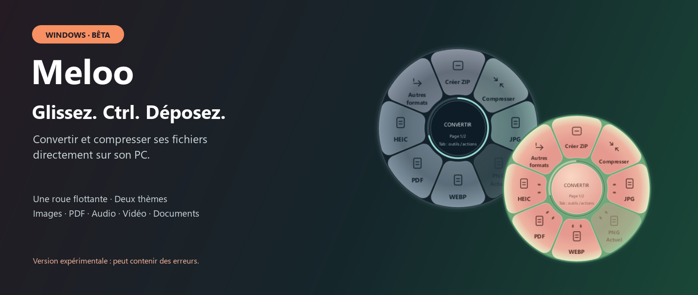
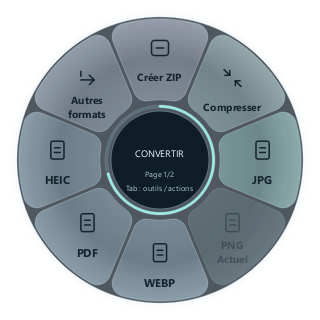

# Meloo pour Windows · BÊTA

Convertir, compresser et organiser ses fichiers depuis une roue flottante.
Meloo reste dans la zone de notification : commencez à glisser un fichier depuis
l’Explorateur, appuyez sur **Ctrl**, puis déposez-le sur une destination.

**[⬇ Télécharger Meloo 0.4.2 BÊTA — installateur Windows .EXE](https://github.com/bhuit/Meloo/releases/download/v0.4.2/Meloo-0.4.2-Setup-x64.exe)**

**[Lire le guide illustré](LISEZMOI.md)** · [Toutes les versions](https://github.com/bhuit/Meloo/releases) · [Signaler un problème](https://github.com/bhuit/Meloo/issues)

> **Version bêta : elle peut contenir des erreurs, des conversions imparfaites ou des fonctions encore instables.**
> Gardez une copie de vos fichiers importants et vérifiez le résultat avant de l’utiliser.

## Vos fichiers, directement sur votre PC

| Une roue à portée de souris | Des outils adaptés au fichier | Deux ambiances |
| --- | --- | --- |
| Ctrl pendant un glissement ouvre les destinations. | Images, PDF, audio, vidéo, documents et archives. | Orange ou Melina, avec les mêmes fonctionnalités. |

## Télécharger

Les installateurs sont disponibles dans les [versions GitHub](https://github.com/bhuit/Meloo/releases).
Choisissez le fichier **Meloo-…-Setup-x64.exe**. Le ZIP « Source code » sert au développement.

- Windows 10 ou 11, processeur x64.
- Installation pour l’utilisateur courant, dossier au choix, raccourcis et désinstallation.
- Les moteurs inclus permettent le traitement local sans compte ni connexion Internet.
- Prévoir environ 2,5 Go pour l’installation, en plus des fichiers produits.
- L’installateur n’est pas signé avec un certificat éditeur. Vérifiez son SHA-256 avec le fichier de sommes fourni.

## Utilisation

1. Lancez Meloo : l’icône apparaît près de l’horloge, éventuellement parmi les icônes masquées.
2. Glissez un fichier depuis l’Explorateur ou le Bureau et appuyez sur **Ctrl**.
3. Déposez-le sur un format ou sur **Créer ZIP**, toujours en haut.
4. Les résultats sont enregistrés à côté des originaux, sauf choix différent dans les réglages.

Un clic droit sur l’icône ouvre les réglages, l’atelier et la configuration des fonctionnalités.
Les thèmes **Orange** et **Melina** s’appliquent à l’application entière.
Déplacez la roue par son centre ; **Tab** change de rubrique et **Échap** la ferme.

### La roue, en deux styles

| Orange | Melina |
| --- | --- |
|  |  |

Le type du fichier détermine les formats proposés. **Créer ZIP** conserve sa place en haut.
Le format actuel est grisé ; **Autres formats** ouvre les destinations suivantes.

### Visez le résultat souhaité

Pour un PDF, la roue propose notamment Word, PowerPoint, Excel ou une image.
Le secteur visé s’éclaire : relâchez le fichier dessus pour lancer la conversion.

| Vers Word | Vers PowerPoint |
| --- | --- |
|  |  |

Ces deux illustrations viennent de captures fournies par l’utilisateur ; les aperçus de documents ont été remplacés par une démo.
La fidélité de PDF → Word dépend du document. PDF → PowerPoint place chaque page sous forme d’image sur une diapositive.

### L’atelier : du fichier au résultat

Fichiers à gauche, choix de destination au centre et résultats à droite.
L’atelier s’ouvre depuis le menu de l’icône ; le geste Ctrl fonctionne aussi avec la roue seule.

### Personnalisez votre espace

**Clic droit sur l’icône Meloo, près de l’horloge → Réglages.**
Si l’icône est masquée, ouvrez d’abord la petite flèche de la zone de notification Windows.

Le menu donne accès à **Afficher la roue**, **Réglages**, **Fonctionnalités…**, **Atelier avancé**, **Derniers résultats** et **Quitter**.

Dans Réglages, le switch **Orange / Melina · Pastèque** change immédiatement les couleurs de la roue,
de l’atelier et des fenêtres. Revenez sur **Orange** pour retrouver le style d’origine. Le choix est mémorisé.

Les fonctionnalités peuvent être activées ou désactivées individuellement dans **Fonctionnalités…**.
Les changements sont enregistrés immédiatement ; les outils visibles restent adaptés au type et au nombre de fichiers.

## Fonctionnalités

| Fichiers | Exemples d’actions |
| --- | --- |
| Images | PNG, JPEG, WebP, AVIF, HEIC, TIFF, BMP, GIF ; retouche, annotation, recadrage, collage, arrière-plan |
| PDF | Compression sans perte, fusion, organisation des pages, extraction et conversions |
| Audio et vidéo | Conversion, compression, coupe, vitesse, assemblage, normalisation audio, captures vidéo |
| Documents | Word, Excel, PowerPoint, OpenDocument, texte et PDF via LibreOffice et Pandoc |
| Tous fichiers | ZIP, empreinte SHA-256, copie, déplacement et partage Windows |

Le [LISEZMOI illustré](LISEZMOI.md#7-les-fonctionnalités-en-détail) explique les outils photo, vidéo, audio et PDF,
les formats de destination et les actions sur les fichiers.

La compression ne garantit pas une réduction de taille pour un fichier déjà optimisé.
PDF → PowerPoint produit des images de pages ; PDF → Excel dépend des tableaux détectables.
Le nettoyage des métadonnées PDF conserve les mentions de logiciel et de droits et n’anonymise pas le contenu.
RAR nécessite un extracteur externe. Pas d’OCR ni de suppression de fond par IA.
Le [guide détaillé](README.txt) décrit les autres fonctions et limites.

Les visuels associent des captures des véritables widgets de Meloo et des captures d’utilisation fournies par l’utilisateur.
Les trois aperçus de documents des captures de glissement ont été remplacés par une démo avec imagegen ; ce sont des illustrations retouchées.
Le schéma en trois étapes est une illustration explicative. Voir la [provenance des images](docs/images/README.md).

## Développement

Voir [la reconstruction et les tests](docs/BUILD.md), les [licences et sources tierces](docs/THIRD_PARTY.md)
et les [changements](CHANGELOG.md). Le module Python garde son nom historique `zeste`.
Les préférences restent dans `%LOCALAPPDATA%\Zeste` pour préserver la compatibilité.

## Licence et crédits

Le code propre à Meloo est sous **GNU AGPL version 3 ou ultérieure** : [LICENSE.txt](LICENSE.txt).
La géométrie de la roue adaptée d’[Open-Tangerine](https://github.com/sintaxerrorpvtltd/Open-Tangerine)
conserve sa licence GPL-3.0-only ; les droits et notices MIT de Satsuma sont conservés.
Voir [NOTICE.txt](NOTICE.txt) et [licenses/](licenses/).

Meloo est un projet indépendant, sans affiliation ni approbation de l’éditeur de Tangerine.
Les noms et marques des composants restent ceux de leurs propriétaires respectifs.

Les fichiers sont traités sur le PC. Meloo n’ajoute ni télémétrie ni téléversement automatique.
Le partage Windows reste une action explicite de l’utilisateur.
